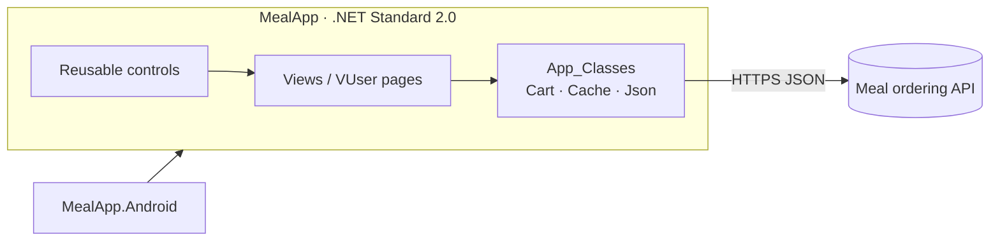

<div align="center">

# 🍔 MealStrike

**Cross-platform meal-ordering app — browse the menu, build a cart, check out and track orders.**

[](https://github.com/mr-aybee/meal-strike/actions/workflows/ci.yml)


[](LICENSE)

</div>

---

## Overview

MealStrike is a Xamarin.Forms mobile client for a restaurant ordering service. Shared UI and logic live in a .NET Standard library, with an Android host app. Customers browse meals, view product details, manage a cart, check out with a saved card and review past orders.

## Features

- 🍽️ **Menu browsing** with meal cards and product details
- 🛒 **Cart** — add, update and remove items
- 💳 **Checkout** with saved cards
- 📦 **Order history** and order details
- 🧭 Shell navigation with a flyout menu
- 💾 Runtime cache and local storage

## Architecture



## Tech stack

| Layer | Technology |
| --- | --- |
| UI | Xamarin.Forms (XAML) · Shell |
| Shared code | C# · .NET Standard 2.0 |
| Platform | Xamarin.Android |
| Serialization | Newtonsoft.Json |

## Getting started

### Prerequisites

- Visual Studio 2022 with the **Mobile development with .NET** workload (Xamarin)
- Android SDK and an emulator or device

### Build

```shell
git clone https://github.com/mr-aybee/meal-strike.git
cd meal-strike
dotnet build MealApp/MealApp/MealApp.csproj -c Release   # shared library
```

Open `MealApp.sln`, set **MealApp.Android** as the startup project and deploy to an emulator or device.

## Usage

1. Configure the API base URL in `MealApp/MealApp/App_Classes` for your backend.
2. Launch the app.
3. Browse meals on **Home**, open a meal for details and add it to the cart.
4. Review the **Cart**, proceed to **Checkout** and pay with a saved card.
5. Track orders under **Orders**.

> Use test data only — the checkout screens do not process live payments by themselves.

## Project structure

```text
meal-strike/
├── MealApp.sln
└── MealApp/
    ├── MealApp/               # Shared .NET Standard project
    │   ├── Views/             # Entry and home pages
    │   ├── VUser/uViews/      # Cart, checkout, orders, product details, cards
    │   ├── Controls/          # Meal, cart and order item controls
    │   └── App_Classes/       # Cart, cache, JSON and helpers
    └── MealApp.Android/       # Android host
```

## Development

- CI builds the shared .NET Standard project on every push and pull request. The Android host needs the Xamarin workload, so it is built locally.
- A migration to .NET MAUI is the recommended path for new platform work, since Xamarin support has ended.

## Contributing

Contributions are welcome. Read [CONTRIBUTING.md](CONTRIBUTING.md) for the branch, build and pull-request workflow. Please report security issues privately through [GitHub security advisories](https://github.com/mr-aybee/meal-strike/security/advisories/new), not public issues.

## Code of Conduct

This project follows the [Contributor Covenant](CODE_OF_CONDUCT.md). By participating you agree to uphold it.

## License

Released under the [MIT License](LICENSE). © 2026 Abdullah Shahid.
